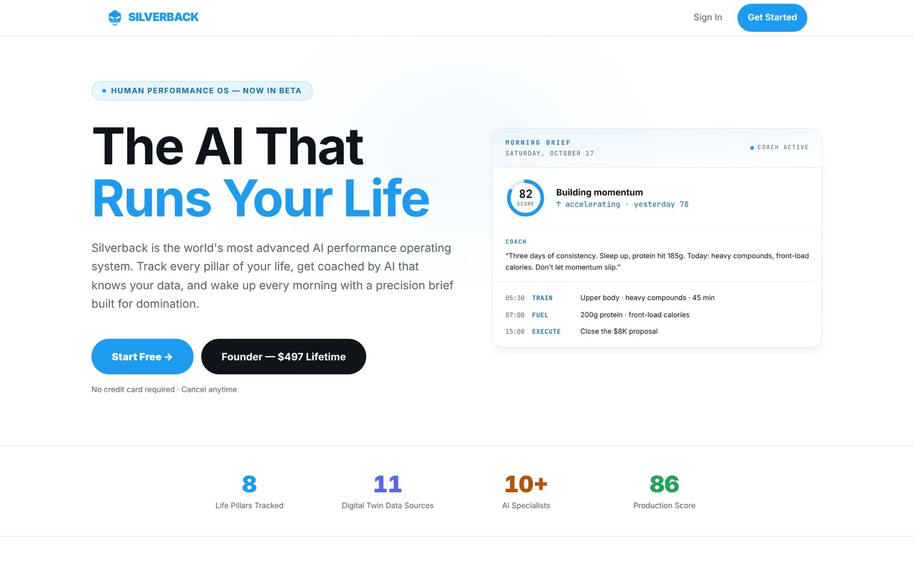

# Silverback OS

**The AI that runs your life — a human performance operating system.**

`Beta on the web · native iOS and Android apps in testing`

[www.silverbackos.com](https://www.silverbackos.com)

---

Track every pillar of your life, get coached by an AI that knows your data, and wake up every morning to a precision brief. Native iOS and Android apps share one backend with the web app.

## Highlights

- AI coaching that knows your data
- Workout logging with history, photos and monthly recaps
- Nutrition tracking (Fuel)
- Daily check-ins and a morning brief
- Ranks, streaks and a community feed

## Platforms & stack

| Platform | Stack |
|---|---|
| Web | Next.js 14, React, TypeScript, Tailwind CSS, Supabase, Stripe, Claude API, Sentry |
| iOS | SwiftUI, Supabase, RevenueCat, Sentry |
| Android | Kotlin, Jetpack Compose, Material 3, supabase-kt, Ktor, Sentry |

## Screenshots

Silverback web home page

---

This repository is a public showcase: documentation and media only. The source code is proprietary and lives in a private repository.

© 2026 Esteban Ibarra. All rights reserved. See [NOTICE](NOTICE). · [More projects](https://github.com/esteban572) · [estebanibarra.dev](https://www.estebanibarra.dev)
